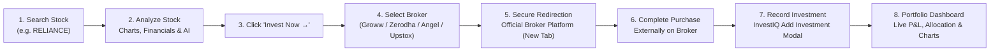

# InvestIQ — Investment & Portfolio Management System

> **InvestIQ** is a professional Indian stock market analysis, broker redirection, and investment portfolio tracking platform built with **React.js, Vite, Node.js, Express, MongoDB, and Clerk Authentication**.

---

## 🌟 Overview & Key Capabilities

InvestIQ empowers Indian equity investors to:
1. **Analyze Indian Equities** — Live NSE prices, interactive Line and Candlestick charts with real OHLC wicks and volume bars, 52-week ranges, fundamentals, quarterly/yearly financials, and AI company briefings.
2. **1-Click Broker Redirection** — Prominent **Invest Now →** routing to verified order pages on India's top stockbrokers:
   - **Groww**
   - **Zerodha Kite**
   - **Angel One**
   - **Upstox**
3. **Phase 1 & Phase 2 Portfolio Management** — Record purchases with whole shares, buy prices, and transaction charges (`Purchase Value = Qty × Price`, `Total Cost = Purchase Value + Charges`).
4. **Weighted-Average Cost Basis** — Automatically aggregates multiple purchases of the same stock under the same broker into a clean holdings table with weighted-average buy price (`Sum(Qty × Price) / Sum(Qty)`).
5. **Phase 3 Advanced Financial Analytics & Live Valuation**:
   - **6 Metric Summary Cards**: Total Invested, Current Value, Unrealized P&L, Return %, Total Holdings, and Best/Worst Performers with data freshness badge and manual debounced refresh.
   - **Market Quote Integration**: Distinguishes Live, Delayed, Previous Close, and Unavailable prices with partial valuation notices.
   - **Allocation Charts**: Multi-mode Recharts visualization for Company (Donut), Broker (Bar), and Sector (Pie) distributions.
   - **Historical Performance Trajectory**: Interactive Line Chart tracking portfolio valuation over time with period selectors (`1W`, `1M`, `3M`, `6M`, `1Y`, `ALL`).
   - **Gainers & Losers**: Top 5 Gainers and Top 5 Losers cards with return %, P&L, and links to stock research.
   - **Broker Breakdown**: Capital and P&L cards segmented by broker.
   - **Rule-Based Insights**: Objective descriptive insights (Concentration, Win Rate, Sector Exposure, Broker Spread, Data Coverage).
   - **Report Export**: 1-click CSV download and clean Print/PDF stylesheet.
6. **Phase 4 Secure Broker Integration & Multi-Broker Sync**:
   - **Connected Brokers Hub** (`/connected-brokers`): Direct management of Zerodha Kite, Upstox, Angel One, and Groww connections.
   - **Zero-Credential Security Architecture**: Strict enforcement of zero-password and zero-TOTP collection. Direct OAuth authorization via official broker portals only.
   - **Token Encryption at Rest**: AES-256-GCM encryption with 96-bit IVs and authentication tags for all access and refresh tokens.
   - **Anti-CSRF Protection**: Cryptographic HMAC-SHA256 state tokens validating user and broker context across OAuth redirects.
   - **Unified Holdings Deduplication**: Intelligent reconciliation engine matching manual transaction logs with broker snapshots to prevent double-counting.
   - **Rate-Limited Synchronizer**: 60-second minimum sync throttle, daily session expiry tracking, and resilient offline preservation.
7. **User Data Isolation** — Clerk Authentication integration scoping client storage (`investiq_portfolio_${userId}`) and backend server records per authenticated user.

---

## 🚀 Complete User Flow



---

## 🏗️ Architecture & Technology Stack

| Layer | Technologies |
|---|---|
| **Frontend** | React 18, Vite 5, Tailwind CSS 3, React Router v6, Recharts, Lucide Icons, `@clerk/react` |
| **Backend** | Node.js (v18+), Express.js 4, Mongoose 8 / MongoDB, `jose` (JWT verification), CORS, Dotenv |
| **Authentication** | Clerk Authentication (Protected Routes, Clerk JWT bearer authorization on server) |
| **Data Services** | Fast yfinance service / NSE fallback directory, in-memory caching (15-min TTL) |
| **Database** | MongoDB Atlas / Local MongoDB Mongoose models with persistent local store fallback |

---

## 📁 Project Structure

```text
InvestIQ-/
├── package.json                   # Root package runner (dev, dev:frontend, dev:backend, test)
├── README.md                      # Comprehensive project documentation
├── backend/                       # Express Node.js API server (Port 5050)
│   ├── config/
│   │   └── db.js                  # MongoDB connection & local fallback handler
│   ├── data/
│   │   └── investments_data.json  # Persistent local store fallback (offline resilience)
│   ├── middleware/
│   │   └── auth.js                # Clerk JWT Bearer authentication middleware
│   ├── models/
│   │   ├── Stock.js               # Mongoose schema for cached stock profiles
│   │   ├── Investment.js          # Mongoose schema for user stock purchases
│   │   └── BrokerSync.js          # Mongoose schema for broker integration state
│   ├── routes/
│   │   ├── stockRoutes.js         # /api/stocks (prices, history, financials, AI summary)
│   │   └── portfolioRoutes.js     # /api/portfolio (CRUD investments, summary, prices, brokers)
│   ├── services/
│   │   ├── portfolioStore.js      # Data Access Layer (MongoDB + local fallback)
│   │   ├── growwService.js        # Groww financial statement parser
│   │   ├── nseService.js          # NSE India service & directory fallback
│   │   └── pythonDataService.js   # yfinance gateway integration
│   ├── test/
│   │   ├── portfolio.test.js      # 29 automated tests for auth, validation, CRUD & P&L
│   │   ├── brokerIntegration.test.js # 15 automated tests for AES-256-GCM, OAuth, CSRF & sync
│   │   └── realtimeEngine.test.js # 19 automated tests for IST market hours, indicators, & alerts
│   ├── server.js                  # Express application entrypoint
│   └── .env.example               # Backend environment variables template
├── frontend/                      # React + Vite Single Page Application
│   ├── src/
│   │   ├── components/
│   │   │   ├── BrokerLogo.jsx     # Authentic SVG logos (Groww, Zerodha, Angel One, Upstox)
│   │   │   ├── CompanyLogo.jsx    # Company favicon & logo resolver
│   │   │   ├── AddInvestmentModal.jsx # Dynamic form with live Quantity × Price calculation
│   │   │   ├── StockDetailDashboard.jsx # Stock analysis view with Invest Now buttons
│   │   │   └── ProtectedRoute.jsx # Clerk auth route protection
│   │   ├── data/
│   │   │   ├── brokerConfig.js    # Verified broker URLs, descriptions, & pricing
│   │   │   └── popularTickers.js  # Popular NSE tickers catalog
│   │   ├── pages/
│   │   │   ├── Home.jsx           # Landing page with market overview
│   │   │   ├── Dashboard.jsx      # User dashboard with real portfolio widgets
│   │   │   ├── CompanyPage.jsx    # Stock detail route wrapper
│   │   │   ├── InvestmentPage.jsx # /invest Broker Selection & stock showcase
│   │   │   ├── PortfolioPage.jsx  # /portfolio Dedicated portfolio dashboard
│   │   │   └── Watchlist.jsx      # Watchlist management
│   │   ├── services/
│   │   │   └── api.js             # Axios client with authenticated token headers
│   │   ├── App.jsx                # Router & navigation header (Portfolio, Invest links)
│   │   └── main.jsx               # ClerkProvider initialization
│   └── .env.example               # Frontend environment variables template
```

---

## 🔑 Environment Variables Setup

### 1. Frontend (`frontend/.env.local`)
Create `frontend/.env.local` using the template below:
```env
# Clerk Authentication Publishable Key
VITE_CLERK_PUBLISHABLE_KEY=pk_test_dGVuZGVyLXNsdWctNDIwMC5jbGVyay5hY2NvdW50cy5kZXYk

# Backend API Base URL
VITE_API_URL=http://localhost:5050/api
```

### 2. Backend (`backend/.env`)
Create `backend/.env` using the template below:
```env
# Server Port
PORT=5050
HOST=127.0.0.1

# Database (MongoDB connection string)
MONGO_URI=mongodb://127.0.0.1:27017/stocksense

# Python Data Service URL (Optional)
PYTHON_DATA_SERVICE_URL=http://127.0.0.1:8000

# Clerk Authentication (Session validation & JWT parsing)
CLERK_SECRET_KEY=sk_test_VXtrCCl9SleV8hngxP6TC9WjxUuh2Xw1ZQYYdqjXoy
CLERK_PUBLISHABLE_KEY=pk_test_dGVuZGVyLXNsdWctNDIwMC5jbGVyay5hY2NvdW50cy5kZXYk

# Optional API Keys
OPENAI_API_KEY=your_openai_api_key_here
GROWW_API_KEY=your_groww_api_key_here
```

---

## 📦 Installation & Setup Guide

### Prerequisites
- **Node.js** v18.0.0 or higher
- **npm** v9.0.0 or higher
- **MongoDB** (Local `mongod` or MongoDB Atlas cloud connection)

### 1. Install Dependencies
From the project root:
```bash
# Install backend dependencies
cd backend && npm install

# Install frontend dependencies
cd ../frontend && npm install

# Return to root
cd ..
```

### 2. Run Automated Backend Tests
Verify all authentication, input validation, CRUD operations, calculations, and broker sync:
```bash
npm run test
# Output: Verification Complete: 29 Passed, 0 Failed
```

### 3. Build Frontend
```bash
npm run build:frontend
```

### 4. Start the Application
Run frontend and backend in separate terminal windows:

**Terminal 1 (Backend API):**
```bash
cd backend
npm run dev
# Server will start on http://127.0.0.1:5050
```

**Terminal 2 (Frontend Client):**
```bash
cd frontend
npm run dev
# Vite client will start on http://localhost:5173
```

---

## 📡 API Reference

### Stock Analysis Endpoints
- `GET /api/stocks/:ticker` — Get stock details (last price, day change, 52W range, market cap, P/E).
- `GET /api/stocks/:ticker/history` — Get 5-year historical price series.
- `GET /api/stocks/:ticker/financials` — Get real quarterly & yearly revenue/profit from Groww.
- `GET /api/stocks/:ticker/ai-summary` — Get AI company brief.

### Portfolio Endpoints (Requires `Authorization: Bearer <ClerkJWT>`)
- `GET /api/portfolio/investments` — List all stock holdings for the authenticated user.
- `POST /api/portfolio/investments` — Record a new purchase.
  - Body: `{ companyName, stockSymbol, brokerName, quantity, purchasePrice, purchaseDate, exchange, notes }`
  - Automatically calculates: `totalInvestment = quantity × purchasePrice`.
- `PUT /api/portfolio/investments/:id` — Update existing investment record.
- `DELETE /api/portfolio/investments/:id` — Delete investment record.
- `GET /api/portfolio/summary` — Retrieve aggregate metrics:
  - `totalInvested`: Sum of all purchase amounts.
  - `currentValue`: Current market value based on live stock prices.
  - `totalPnl` and `totalPnlPercent`: Returns formatted with color indicators.
  - `brokerDistribution`: Breakdown of capital across Groww, Zerodha, Angel One, Upstox.
  - `holdings`: Enriched list with live prices and individual P&L.
- `GET /api/portfolio/prices?symbols=RELIANCE,TCS` — Batch price lookup for portfolio stocks.
- `GET /api/portfolio/brokers` — Read broker sync status for supported brokers.
- `POST /api/portfolio/brokers/sync` — Trigger broker holding sync with explicit user consent.
- `GET /api/portfolio/synced-holdings` — List synchronized holdings from connected brokers.
- `GET /api/portfolio/unified` — Retrieve deduplicated portfolio (Manual + Synced).
- `GET /api/portfolio/reconciliation` — Retrieve reconciliation records and variance review logs.

### Broker Connection Endpoints
- `GET /api/brokers` — Catalog of supported brokers, auth methods, and official docs.
- `GET /api/brokers/connections` — List user's active broker connections with connection status.
- `POST /api/brokers/:broker/connect` — Initiate official OAuth flow with anti-CSRF state token.
- `GET /api/brokers/:broker/callback` — OAuth callback handler, exchanging token & encrypting at rest.
- `POST /api/brokers/connections/:broker/sync` — Rate-limited manual holdings synchronization.
- `DELETE /api/brokers/connections/:broker` — Disconnect broker account and revoke tokens.

---

## 🛡️ Security & Broker Compliance

- **No Order Execution on InvestIQ**: InvestIQ never handles trading funds or depository tokens. All orders execute on the broker's official SEBI-regulated platform.
- **Zero-Credential Collection**: InvestIQ never collects or stores broker passwords, PINs, or TOTP codes.
- **AES-256-GCM Token Encryption**: Broker tokens are encrypted at rest with 96-bit initialization vectors.
- **Verified URLs**: Links are strictly verified to authentic broker domains (`groww.in`, `kite.zerodha.com`, `trade.angelone.in`, `pro.upstox.com`). No fake trading URLs are ever generated.
- **Server-Side Authentication**: User IDs are extracted strictly from verified Clerk JWT tokens on the server. The backend never trusts client-supplied user IDs.
- **Isolated User Storage**: Every database query is scoped strictly to the authenticated `userId`.
- **Read-Only Sync Architecture**: Broker auto-sync requires explicit, opt-in user consent and maintains duplicate prevention before updating holdings.

---

## 🧪 Automated Tests & Build Verification

Run the automated test suites:
```bash
# 1. Run Complete Backend Suites (Security, Broker Integration, Real-Time Engine, Indicators, Alerts) (63 tests)
cd backend && npm test

# 2. Run Dedicated Real-Time Market Data & Indicators Suite (19 tests)
node backend/test/realtimeEngine.test.js

# 3. Run Phase 3 Financial Analytics & Valuation tests (7 tests)
node frontend/test/portfolioAnalytics.test.mjs

# 4. Run Phase 1 Portfolio Storage calculation & aggregation tests (6 tests)
node frontend/test/portfolioStorage.test.mjs

# 5. Verify Frontend Production Build
cd frontend && npm run build
```

---

## 📊 Real-Time Stock Market Dashboard (Phase 5)

InvestIQ features a genuine, production-grade real-time market data streaming architecture designed specifically for Indian equities (NSE / BSE):

### 1. Market Data Provider Selection & Licensing Architecture
- **Market Data Redistribution Compliance**: SEBI regulations and NSE / BSE exchange guidelines strictly prohibit public broadcast of real-time ticks derived from personal retail broker trading APIs (Zerodha Kite Connect, Upstox, FYERS, Groww) to third parties without an authorized Exchange Data Vendor Agreement directly with **NSE Data & Analytics Ltd** or **BSE Ltd**.
- **Transparent Freshness Labeling**: InvestIQ never fakes live ticks. Data freshness is honestly labeled:
  - `LIVE`: Streamed from connected broker session or authorized low-latency vendor.
  - `DELAYED`: Compliant 15-minute delayed market snapshot.
  - `MARKET_CLOSED`: Session closed (after 15:30 IST, weekends, or NSE national holidays).
  - `OFFLINE_SNAPSHOT`: Fallback company profile with verified baseline market metrics when offline.

### 2. Real-Time Streaming Gateway (Server-Sent Events)
- **Streaming Gateway** (`GET /api/stocks/stream`): Authorized HTTP streaming gateway supporting dynamic symbol subscriptions (`?symbols=RELIANCE,TCS`), user-scoped price alert monitoring (`?token=...`), automatic connection pooling, and 15-second keepalive heartbeats.
- **Client Manager (`realtimeClient.js`)**: Shared singleton EventSource connection with subscription deduplication, exponential backoff reconnection, and zero token exposure in frontend bundles.

### 3. Professional Candlestick Chart & Multi-Timeframe Selectors
- **Multi-Timeframe Selection**: `1m`, `5m`, `15m`, `1h`, `1D`, `1W`, and `1M` candles.
- **Dynamic Tick Absorption**: Real-time incoming ticks update the active candle's close, high, low, and volume dynamically without full chart re-renders.
- **Interactive Crosshair HUD**: Synchronized readout displaying Date, Open, High, Low, Close, Volume, and active indicator values on cursor hover.
- **Fullscreen Mode**: Expandable SVG viewport with ESC key shortcut.

### 4. Mathematical Technical Indicators
- **SMA (20, 50, 200)**: Simple Moving Averages for short, intermediate, and long-term trend analysis.
- **EMA (9, 20, 50)**: Exponential Moving Averages calculated with multiplier $k = 2 / (N + 1)$.
- **RSI (14)**: Relative Strength Index with Wilder's exponential smoothing bounded in $[0, 100]$, with 70 overbought and 30 oversold sub-chart thresholds.
- **MACD (12, 26, 9)**: Moving Average Convergence Divergence line, 9-period Signal line, and color-coded momentum histogram.
- **Bollinger Bands (20, 2)**: 20-period moving average with $\pm 2\sigma$ standard deviation bands and translucent envelope.
- **Volume MA (20)**: Volume moving average overlay identifying accumulation and distribution spikes.

### 5. Live Market Overview & Watchlist
- **Major Indices**: Real-time NIFTY 50, SENSEX, and BANK NIFTY tracking.
- **Tracked Universe Rankings**: Top 5 Gainers, Top 5 Losers, and Most Active stocks across the tracked NIFTY 50 universe.
- **Performance Sorting**: Sort watchlist by Daily Return % (Gainers/Losers), Price, or Alphabetical order.

### 6. Real-Time Price Alerts
- **Configurable Rules**: `ABOVE` target price, `BELOW` target price, or intraday `PERCENT_CHANGE` threshold.
- **Server-Side Evaluation**: Evaluated against every incoming market quote tick.
- **Delivery**: Dispatched via real-time stream with audit timestamps and duplicate notification prevention.

---

## 🎨 Professional Editorial Landing Page

InvestIQ features a handcrafted, product-led editorial landing page (`/`) designed with the restraint, precision, and typography of premium developer and financial software (inspired by Linear, Stripe, and Vercel):

### 1. Strict Design System & Color Palette
- **Background**: `#FAFAF8` (warm editorial alabaster)
- **Primary Text / Headings**: `#15191E` (deep obsidian)
- **Secondary / Body Text**: `#64707D` (slate gray)
- **Hairline Borders**: `#E4E7EB` (neutral border)
- **Dark Contrast Section**: `#101820` (dense midnight black for trust & final CTA)
- **Accent Color**: `#176B58` (deep pine forest green)
- **Accent Hover**: `#115343` (darkened pine green)
- **Negative Indicator**: `#C0392B` (restrained vermilion red)
- **Zero Clutter Guarantee**: Strictly zero neon purple/blue gradients, glowing halos, floating 3D spheres, fake testimonials, or fabricated user statistics.

### 2. Page Architecture & Sections
1. **Sticky Header Navigation**:
   - Logo with geometric chevron icon, brand typography, and live NSE market status indicator.
   - Smooth anchor links (`#platform`, `#features`, `#markets`, `#trust`) and Clerk authentication modal buttons (`Sign In`, `Get Started` / `Go to Dashboard`).
   - Mobile-responsive slide-out menu drawer with accessible backdrop blur.
2. **Editorial Hero Section**:
   - Eyebrow: `MARKET INTELLIGENCE, SIMPLIFIED`
   - Main Headline: `The market moves fast. Stay a step ahead.`
   - Subheading: `Research stocks, follow market movements, and understand your portfolio—all in one focused workspace.`
   - Action Row: `Get Started Free →` (opens Clerk signup modal) and `Explore Platform ↓` (smooth scroll to interactive demo).
   - Micro-trust note: `No credit card required • Connects with India's top 4 brokers • Bank-grade encryption`.
3. **Realistic Product Demo Canvas**:
   - Browser chrome frame featuring live Indian equity data: `RELIANCE.NS` trading at `₹2,985.40 (+₹38.20 / +1.30%)`.
   - Multi-timeframe selector (`1m`, `5m`, `15m`, `1D`, `1W`, `1M`).
   - Real interactive SVG Candlestick Chart with bull/bear wicks, candle bodies, volume bars, and overlayed 20-period Simple Moving Average (`SMA 20`).
   - Technical indicator status pills (`SMA 20: ₹2,942.10`, `RSI 14: 58.4 - Neutral Momentum`).
   - Realistic market statistics grid: Day Range (`₹2,942.00 – ₹2,994.80`), Volume (`4.82M`), Market Cap (`₹20.20T`), P/E (`27.4`).
4. **Four Core Capabilities**:
   - **Research Stocks**: Clean fundamentals, quarterly statements, 52-week statistics, and key financial ratios.
   - **Follow the Market**: Real-time NSE/BSE quotes, intraday movements, multi-period candlesticks, and market hours awareness.
   - **Understand Your Portfolio**: Aggregated multi-broker holdings, weighted-average purchase prices, live P&L, and asset allocation.
   - **Connect Supported Brokers**: Read-only synchronization with Groww, Zerodha Kite, Angel One, and Upstox via official OAuth.
5. **Alternating Editorial Deep-Dives**:
   - *Feature 1: Technical Precision Without Noise* — Multi-timeframe charts, overlays, volume profiles, and mathematical indicators.
   - *Feature 2: Multi-Broker Consolidation* — Unified visibility across accounts with zero credential collection and OAuth security.
   - *Feature 3: Portfolio Accuracy* — Realized vs unrealized P&L, transaction cost impact, and capital allocation across Indian sectors.
6. **Factual Trust & Transparency Disclosures**:
   - Market Data Timing: Standard NSE/BSE operating hours (09:15–15:30 IST) with distinct state badges.
   - Independent Research: Unbiased financial intelligence with no proprietary trading desk or sponsored order flow.
   - Broker Routing: Orders execute directly on registered member brokerages; InvestIQ never holds client custody.
   - Capital Risk: Factual compliance disclaimer regarding market volatility and investment risks.
7. **Dark Final Call to Action (`#101820`)**:
   - Headline: `Make sense of every market move.`
   - Direct entry into the platform via Clerk authentication.
8. **Clean Four-Column Footer**:
   - Product, Markets, Security & Trust, and Company navigational links with full copyright and compliance statements.

---

## 🧭 Testing the Complete Investment Flow

1. **Sign In**: Launch `http://localhost:5173`, click **Get Started** or **Sign In** with Clerk.
2. **Search Stock**: Search for `RELIANCE` or `TCS` in the search bar.
3. **View Details**: Review the live price, Line/Candlestick chart, 52-week range, and financials.
4. **Click Invest Now**:
   - Click the prominent **Invest Now →** button in the header or in the overview card.
   - The Investment page opens at `/invest` with the company details preselected.
5. **Select Broker**:
   - Choose **Groww**, **Zerodha Kite**, **Angel One**, or **Upstox**.
   - Click **Invest with Broker**.
   - The official broker platform opens in a secure new browser tab.
6. **Record Purchase**:
   - In InvestIQ, the prompt banner displays **I've Completed My Investment** or **Add to My Portfolio**.
   - Click to open the pre-filled modal, enter quantity (whole shares), buy price, and optional transaction charges.
   - Observe live **Total Cost = Purchase Value + Transaction Charges** calculation.
   - Click **Save Investment**.
7. **View Portfolio Dashboard**:
   - Navigate to `/portfolio`.
   - Inspect **Total Invested Amount**, **Total Transactions**, **Total Companies**, and **Brokers Represented**.
   - View **Aggregated Holdings** table (with weighted-average purchase prices).
   - View **Transaction History** table with search, broker/company filters, and Edit/Delete controls.
   - Test **Edit** and **Delete** (with confirmation dialog).

---

## 📄 License & Attribution

InvestIQ is developed for Indian equity research, broker routing, and investment portfolio management.
© 2026 InvestIQ. All rights reserved.
