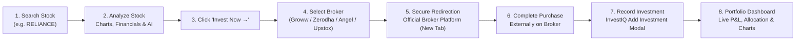

# InvestIQ — Investment & Portfolio Management System

> **InvestIQ** is a professional Indian stock market analysis, broker redirection, and investment portfolio tracking platform built with **React.js, Vite, Node.js, Express, MongoDB, and Clerk Authentication**.

---

## 🌟 Overview & Key Capabilities

InvestIQ empowers Indian equity investors to:
1. **Analyze Indian Equities** — Live NSE prices, 5-year interactive charts, 52-week ranges, fundamentals, quarterly/yearly financials, and AI company briefings.
2. **1-Click Broker Redirection** — Prominent **Invest Now →** routing to verified order pages on India's top stockbrokers:
   - **Groww**
   - **Zerodha Kite**
   - **Angel One**
   - **Upstox**
3. **Dedicated Portfolio Dashboard** — Record stock purchases, track total invested capital, live portfolio value, net profit/loss (₹ and %), broker-wise investment distribution charts, and edit/delete holdings.
4. **Broker Sync Architecture** — Future-ready read-only synchronization with explicit user consent, timestamps, and duplicate prevention.
5. **Secure Authentication** — Clerk Authentication protecting investment and portfolio routes, with backend Clerk JWT verification isolating data per authenticated user.

---

## 🚀 Complete User Flow



---

## 🏗️ Architecture & Technology Stack

| Layer | Technologies |
|---|---|
| **Frontend** | React 18, Vite 5, Tailwind CSS 3, React Router v6, Recharts, Lucide Icons, `@clerk/react` |
| **Backend** | Node.js (v18+), Express.js 4, Mongoose 8 / MongoDB, `jose` (JWT verification), CORS, Dotenv |
| **Authentication** | Clerk Authentication (Protected Routes, Clerk JWT bearer authorization on server) |
| **Data Services** | Fast yfinance service / NSE fallback directory, in-memory caching (15-min TTL) |
| **Database** | MongoDB Atlas / Local MongoDB Mongoose models with persistent local store fallback |

---

## 📁 Project Structure

```text
InvestIQ-/
├── package.json                   # Root package runner (dev, dev:frontend, dev:backend, test)
├── README.md                      # Comprehensive project documentation
├── backend/                       # Express Node.js API server (Port 5050)
│   ├── config/
│   │   └── db.js                  # MongoDB connection & local fallback handler
│   ├── data/
│   │   └── investments_data.json  # Persistent local store fallback (offline resilience)
│   ├── middleware/
│   │   └── auth.js                # Clerk JWT Bearer authentication middleware
│   ├── models/
│   │   ├── Stock.js               # Mongoose schema for cached stock profiles
│   │   ├── Investment.js          # Mongoose schema for user stock purchases
│   │   └── BrokerSync.js          # Mongoose schema for broker integration state
│   ├── routes/
│   │   ├── stockRoutes.js         # /api/stocks (prices, history, financials, AI summary)
│   │   └── portfolioRoutes.js     # /api/portfolio (CRUD investments, summary, prices, brokers)
│   ├── services/
│   │   ├── portfolioStore.js      # Data Access Layer (MongoDB + local fallback)
│   │   ├── growwService.js        # Groww financial statement parser
│   │   ├── nseService.js          # NSE India service & directory fallback
│   │   └── pythonDataService.js   # yfinance gateway integration
│   ├── test/
│   │   └── portfolio.test.js      # 29 automated tests for auth, validation, CRUD & P&L
│   ├── server.js                  # Express application entrypoint
│   └── .env.example               # Backend environment variables template
├── frontend/                      # React + Vite Single Page Application
│   ├── src/
│   │   ├── components/
│   │   │   ├── BrokerLogo.jsx     # Authentic SVG logos (Groww, Zerodha, Angel One, Upstox)
│   │   │   ├── CompanyLogo.jsx    # Company favicon & logo resolver
│   │   │   ├── AddInvestmentModal.jsx # Dynamic form with live Quantity × Price calculation
│   │   │   ├── StockDetailDashboard.jsx # Stock analysis view with Invest Now buttons
│   │   │   └── ProtectedRoute.jsx # Clerk auth route protection
│   │   ├── data/
│   │   │   ├── brokerConfig.js    # Verified broker URLs, descriptions, & pricing
│   │   │   └── popularTickers.js  # Popular NSE tickers catalog
│   │   ├── pages/
│   │   │   ├── Home.jsx           # Landing page with market overview
│   │   │   ├── Dashboard.jsx      # User dashboard with real portfolio widgets
│   │   │   ├── CompanyPage.jsx    # Stock detail route wrapper
│   │   │   ├── InvestmentPage.jsx # /invest Broker Selection & stock showcase
│   │   │   ├── PortfolioPage.jsx  # /portfolio Dedicated portfolio dashboard
│   │   │   └── Watchlist.jsx      # Watchlist management
│   │   ├── services/
│   │   │   └── api.js             # Axios client with authenticated token headers
│   │   ├── App.jsx                # Router & navigation header (Portfolio, Invest links)
│   │   └── main.jsx               # ClerkProvider initialization
│   └── .env.example               # Frontend environment variables template
```

---

## 🔑 Environment Variables Setup

### 1. Frontend (`frontend/.env.local`)
Create `frontend/.env.local` using the template below:
```env
# Clerk Authentication Publishable Key
VITE_CLERK_PUBLISHABLE_KEY=pk_test_dGVuZGVyLXNsdWctNDIwMC5jbGVyay5hY2NvdW50cy5kZXYk

# Backend API Base URL
VITE_API_URL=http://localhost:5050/api
```

### 2. Backend (`backend/.env`)
Create `backend/.env` using the template below:
```env
# Server Port
PORT=5050
HOST=127.0.0.1

# Database (MongoDB connection string)
MONGO_URI=mongodb://127.0.0.1:27017/stocksense

# Python Data Service URL (Optional)
PYTHON_DATA_SERVICE_URL=http://127.0.0.1:8000

# Clerk Authentication (Session validation & JWT parsing)
CLERK_SECRET_KEY=sk_test_VXtrCCl9SleV8hngxP6TC9WjxUuh2Xw1ZQYYdqjXoy
CLERK_PUBLISHABLE_KEY=pk_test_dGVuZGVyLXNsdWctNDIwMC5jbGVyay5hY2NvdW50cy5kZXYk

# Optional API Keys
OPENAI_API_KEY=your_openai_api_key_here
GROWW_API_KEY=your_groww_api_key_here
```

---

## 📦 Installation & Setup Guide

### Prerequisites
- **Node.js** v18.0.0 or higher
- **npm** v9.0.0 or higher
- **MongoDB** (Local `mongod` or MongoDB Atlas cloud connection)

### 1. Install Dependencies
From the project root:
```bash
# Install backend dependencies
cd backend && npm install

# Install frontend dependencies
cd ../frontend && npm install

# Return to root
cd ..
```

### 2. Run Automated Backend Tests
Verify all authentication, input validation, CRUD operations, calculations, and broker sync:
```bash
npm run test
# Output: Verification Complete: 29 Passed, 0 Failed
```

### 3. Build Frontend
```bash
npm run build:frontend
```

### 4. Start the Application
Run frontend and backend in separate terminal windows:

**Terminal 1 (Backend API):**
```bash
cd backend
npm run dev
# Server will start on http://127.0.0.1:5050
```

**Terminal 2 (Frontend Client):**
```bash
cd frontend
npm run dev
# Vite client will start on http://localhost:5173
```

---

## 📡 API Reference

### Stock Analysis Endpoints
- `GET /api/stocks/:ticker` — Get stock details (last price, day change, 52W range, market cap, P/E).
- `GET /api/stocks/:ticker/history` — Get 5-year historical price series.
- `GET /api/stocks/:ticker/financials` — Get real quarterly & yearly revenue/profit from Groww.
- `GET /api/stocks/:ticker/ai-summary` — Get AI company brief.

### Portfolio Endpoints (Requires `Authorization: Bearer <ClerkJWT>`)
- `GET /api/portfolio/investments` — List all stock holdings for the authenticated user.
- `POST /api/portfolio/investments` — Record a new purchase.
  - Body: `{ companyName, stockSymbol, brokerName, quantity, purchasePrice, purchaseDate, exchange, notes }`
  - Automatically calculates: `totalInvestment = quantity × purchasePrice`.
- `PUT /api/portfolio/investments/:id` — Update existing investment record.
- `DELETE /api/portfolio/investments/:id` — Delete investment record.
- `GET /api/portfolio/summary` — Retrieve aggregate metrics:
  - `totalInvested`: Sum of all purchase amounts.
  - `currentValue`: Current market value based on live stock prices.
  - `totalPnl` and `totalPnlPercent`: Returns formatted with color indicators.
  - `brokerDistribution`: Breakdown of capital across Groww, Zerodha, Angel One, Upstox.
  - `holdings`: Enriched list with live prices and individual P&L.
- `GET /api/portfolio/prices?symbols=RELIANCE,TCS` — Batch price lookup for portfolio stocks.
- `GET /api/portfolio/brokers` — Read broker sync status for supported brokers.
- `POST /api/portfolio/brokers/sync` — Trigger broker holding sync with explicit user consent.

---

## 🛡️ Security & Broker Compliance

- **No Order Execution on InvestIQ**: InvestIQ never handles trading funds or depository tokens. All orders execute on the broker's official SEBI-regulated platform.
- **Verified URLs**: Links are strictly verified to authentic broker domains (`groww.in`, `kite.zerodha.com`, `trade.angelone.in`, `pro.upstox.com`). No fake trading URLs are ever generated.
- **Server-Side Authentication**: User IDs are extracted strictly from verified Clerk JWT tokens on the server. The backend never trusts client-supplied user IDs.
- **Isolated User Storage**: Every database query is scoped strictly to the authenticated `userId`.
- **Read-Only Sync Architecture**: Broker auto-sync requires explicit, opt-in user consent and maintains duplicate prevention before updating holdings.

---

## 🧪 Testing the Complete Investment Flow

1. **Sign In**: Launch `http://localhost:5173`, click **Get Started** or **Sign In** with Clerk.
2. **Search Stock**: Search for `RELIANCE` or `TCS` in the search bar.
3. **View Details**: Review the live price, chart, 52-week range, and financials.
4. **Click Invest Now**:
   - Click the prominent **Invest Now →** button in the header or in the overview card.
   - The Investment page opens at `/invest` with the company details preselected.
5. **Select Broker**:
   - Choose **Groww**, **Zerodha Kite**, **Angel One**, or **Upstox**.
   - Click **Invest with Broker**.
   - The official broker platform opens in a secure new browser tab.
6. **Record Purchase**:
   - In InvestIQ, the prompt card offers **Record Investment in Portfolio**.
   - Click to open the pre-filled modal, adjust quantity and buy price.
   - Observe live **Total Investment = Quantity × Purchase Price** calculation.
   - Click **Save Investment**.
7. **View Portfolio Dashboard**:
   - Navigate to `/portfolio`.
   - Inspect total invested, current market value, total profit/loss (₹ and %), broker distribution chart, and individual holdings.
   - Test **Edit** and **Delete** actions.

---

## 📄 License & Attribution

InvestIQ is developed for Indian equity research, broker routing, and investment portfolio management.
© 2026 InvestIQ. All rights reserved.
